# semilep_vbs_base — CMS VBS semileptonic analysis (Run 2 UL)

Analysis code for the **vector-boson-scattering (VBS) semileptonic** search/measurement in CMS:
`pp → ℓν + qq̄' + 2 forward jets`, with one leptonically decaying W (electron or muon) and one hadronically
decaying W/Z (reconstructed either as two resolved AK4 jets or as one boosted AK8 jet), produced
through the electroweak VBS process. The repository holds the full chain from NanoAOD skims to the final
statistical fit:

```
NanoAOD skims ──► PocketCoffea processing ──► .coffea outputs ──► VBSfit (histograms → datacards → Combine) ──► results
 (FNAL EOS)       Pocket/temporary_workspace    (per year, per        VBSfit/
                  Purdue Analysis Facility       sample group)        lxplus + EOS + CMSSW/Combine
```

| Where you are | Read this |
|---|---|
| Running/maintaining the event processing (selections, weights, nonprompt estimate, BDT) | [`Pocket/temporary_workspace/README.md`](Pocket/temporary_workspace/README.md) |
| Building histograms/datacards and running the fits (per year or full Run 2) | [`VBSfit/README.md`](VBSfit/README.md) |
| Installing PocketCoffea | [Installing PocketCoffea](#installing-pocketcoffea) (below) |

---

## Table of contents

1. [Physics setup at a glance](#1-physics-setup-at-a-glance)
2. [Repository map](#2-repository-map)
3. [End-to-end data flow](#3-end-to-end-data-flow)
4. [Facilities and environments](#4-facilities-and-environments)
5. [Quick start for each stage](#5-quick-start-for-each-stage)
6. [Top-level helper scripts](#6-top-level-helper-scripts)
7. [Cross-cutting conventions](#7-cross-cutting-conventions)
8. [Status notes (dated)](#8-status-notes-dated)
9. [Installing PocketCoffea](#installing-pocketcoffea)

---

## 1. Physics setup at a glance

**Signal.** Electroweak VBS, LO `dipoleRecoil` MadGraph samples (`*_dipoleRecoil_EWK_LO_SM_MJJ100PTJ10_*`):
four WW processes, four WZ processes and one ZZ process (nine samples in all). The signal strength `r`
scales all of them together; `VBSfit/run_multipoi.sh` can split it into `r_WW` and `r_WZ`.

**Backgrounds.**
QCD-induced diboson (same sample names with `QCD_LO_SM_MJJ100PTJ10`), tribosons (WWW/WWZ/WZZ/ZZZ),
WZ→3ℓν, gg→WW, Vγ (ZGToLLG, WGToLNuG), W+jets (HT-binned, stitched with the inclusive sample at
`LHE_HT < 70`), Drell–Yan (amc@NLO, M-50 and M-10to50), t̄t (semileptonic + dileptonic), single top
(five samples), ttW/ttZ, and a **data-driven nonprompt/fake-lepton** estimate (see below).

**Channels.** Four signal regions = topology × lepton flavour:
`resolved_mu`, `resolved_e`, `boosted_mu`, `boosted_e`. Each has two control regions:
`ttbar_cr_<sr>` and `w_cr_<sr>` (the resolved W CR is called `w_cr_mu`/`w_cr_e` inside the coffea
outputs; `VBSfit` maps these names).

| Region | Definition (all share the VBS-jet requirements below) |
|---|---|
| Preselection | exactly 1 good lepton (μ pT>30, e pT>38 with `cutBased≥3`), ≥2 good jets (pT>30), DeepMETResolutionTune pT>30, m_T(W_lep)<185; HEM veto for 2018 EraC/D data |
| **Resolved SR** | single lepton of the right flavour, ≥4 good jets, **b-veto**, no fat-jet candidate with pT>180, loose-lepton veto, hadronic-W candidate pT<200 GeV with &#124;m_jj − 85&#124; < 20 GeV, m_T(W_lep)>30 |
| **Boosted SR** | one fat-jet candidate (τ21<0.45, m_SD<250, **pT>200**) with &#124;m_SD − 92.5&#124; < 22.5 GeV, b-veto, loose-lepton veto, m_T(W_lep)>30 |
| VBS-jet pair (SR & CRs) | m_jj>500 GeV, &#124;Δη_jj&#124;>2.5, leading VBS jet pT>50, subleading pT>30 |
| **t̄t CR** | the SR with the b-veto replaced by ≥1 tight b-tagged jet |
| **W+jets CR** | the SR with the hadronic-W (resolved) / fat-jet m_SD (boosted) window **inverted**, m_T>30 |
| Validation region (VR) | SR structure exactly, with m_T(W_lep) ∈ [20, 30] |

(Definitions are implemented in `Pocket/temporary_workspace/custom_cut_functions.py`; window parameters
live next to each `Cut`.)

**Discriminant.** One XGBoost **10-fold ensemble per category** (`resolved_mu`, `resolved_e`,
`boosted_mu`, `boosted_e`); the event score `bdt_<category>` is the mean of the fold predictions and is
histogrammed natively in 40 uniform bins on [0, 1]. The models are listed per year in
`Pocket/temporary_workspace/params/classifiers.yaml` and evaluated *inside* the PocketCoffea workflow.

**Fit.** A simultaneous fit of the SR BDT shapes and the two CRs (each a **single counting bin**), with
free-floating background normalizations `norm_top_<topology>` and `norm_wjet_<topology>` (range
`[0.2, 5]`) constrained only by the CRs, Barlow–Beeston-lite `autoMCStats 10`, and O(100) shape
nuisances per year. The signal region stays **blind**: fits on data use a *hybrid* dataset (real data in the CRs,
MC pseudo-data in the SRs). See [`VBSfit/README.md`](VBSfit/README.md).

**Data taking periods and luminosity.** `2018` (59.83 fb⁻¹), `2017` (41.48 fb⁻¹), `2016_PostVFP`
(16.98 fb⁻¹), `2016_PreVFP` (19.65 fb⁻¹) — 137.9 fb⁻¹ in total (`params/lumi.yaml`). Triggers
(`params/triggers.yaml`): IsoMu24 (2016/2018) / IsoMu27 (2017); Ele27 (2016) / Ele35 (2017) /
Ele32 (2018) WPTight. Electrons use `SingleElectron` data in 2016/2017 and `EGamma` in 2018.

---

## 2. Repository map

```
semilep_vbs_base/
├── README.md                     ← you are here
├── Pocket/
│   ├── temporary_workspace/      ★ the live PocketCoffea analysis workspace  → its own README
│   ├── run2_UL/                    tutorial-era Run-2 UL example config (see its README)
│   ├── run2_studies/               tutorial-era studies example (see its README)
│   ├── Tutorial_Pocket_VBS_semilep/  introductory PocketCoffea VBS tutorial (see its README)
│   ├── zmumu/                      Z→μμ PocketCoffea tutorial (see its README)
│   └── POCKET_INSTRUCTIONS.pdf     PocketCoffea instructions handout
├── VBSfit/                       ★ histograms → datacards → CMS Combine fits  → its own README
│   ├── python/                     the fit-side library (make_*, plot_*, check_*, ...)
│   ├── config/                     per-year inputs, BDT binning files
│   └── run_*.sh                    pipeline drivers
├── Tutorials/                    awkward-array / uproot hands-on notebooks (Z→μμ by hand)
├── make_plots_multi.py           memory-bounded replacement for `pocket-coffea make-plots`
├── multi_file_plotter.py         batched data/MC plotting over many .coffea files
├── mix_years.py                  merge all .coffea files of a directory (sequential accumulate)
└── latest_mix_years.py           pairwise-tree merge of a directory (lower peak memory)
```

`Pocket/run2_UL`, `Pocket/run2_studies`, `Pocket/Tutorial_Pocket_VBS_semilep` and `Pocket/zmumu` come
from the PocketCoffea tutorial material and early VBS studies; they are kept for reference and are **not
part of the production workflow**. Only `Pocket/temporary_workspace` and `VBSfit` are.

---

## 3. End-to-end data flow

```mermaid
flowchart LR
    A[DAS / skims<br/>FNAL EOS] -->|datasets/*.json| B[config_semilep<br/>SR + columnar output]
    A --> C[config_validation<br/>nominal CR/VR/SR histograms]
    A --> D[config_inverted<br/>inverted-lepton nonprompt pass]
    B -->|ColOut columns| E[outputs/bdt_kfold.py<br/>XGBoost 10-fold training]
    E -->|params/classifiers.yaml| C
    E --> D
    D -->|fake weights, merged per year| F[nonp_v28_YEAR_tag.coffea]
    C -->|cr_v28_YEAR_gNN/output_all.coffea| G[v28 manifest]
    F --> G
    G -->|make_inputs_from_manifest.py| H[VBSfit/config/inputs_v28_YEAR.yaml]
    H --> I[make_histograms.py → ROOT]
    I --> J[make_datacards.py → datacards]
    J --> K[CMS Combine: significance, fits, impacts, breakdowns]
    K --> L[Run-2 combination<br/>run_run2_fits.sh]
```



1. **Skims/datasets** — dataset JSONs (`datasets/`) point PocketCoffea at the skimmed NanoAOD.
2. **`config_semilep`** — signal-region categories with a large per-event *columnar* output (jets 1–6, pairwise
   mass/ΔR/Δφ/Δη, fat-jet taggers, …) that the BDT is trained on.
3. **BDT training** (`Pocket/temporary_workspace/outputs/`) writes the k-fold model JSONs referenced by
   `classifiers.yaml`; the workflow then scores every event (`bdt_<category>`).
4. **`config_validation`** — the nominal data/MC pass: SR, ttbar CR, W CR and validation-region histograms
   with all weights and shape systematics.
5. **`config_inverted`** — the same selections with the lepton ID **inverted**, reweighted by the measured
   fake weights → the nonprompt estimate (five variations).
6. **VBSfit** turns these coffea files into ROOT histograms and Combine datacards, runs the fits per
   year, and finally combines the four year-eras.

Per-year outputs follow a manifest-driven layout (`<stage>_<YEAR>_<GROUP>/output_all.coffea`; see the
workspace README) so each year is processed and fitted independently and combined only at the very end.

---

## 4. Facilities and environments

| Stage | Where | Environment |
|---|---|---|
| PocketCoffea processing (`Pocket/temporary_workspace`) | **Purdue Analysis Facility**, `/work/users/<user>/…`, Dask Gateway executor `dask@purdue-af` | Apptainer image `pocketcoffea:lxplus-el9-latest` + conda env `…/envs/my-env`, local PocketCoffea checkout on `PYTHONPATH` |
| Skim storage | FNAL EOS `root://cmseos.fnal.gov//eos/uscms/store/group/lnujj/semilep_vbs_skim/` | VOMS proxy on a worker-visible path |
| VBSfit (histograms, datacards, Combine) | **lxplus + CERN EOS** (`/eos/user/v/vslokenb/vbs_semilep/sensitivities/VBSfit`), inside `tmux` | **Two** environments, switched by the scripts: CMSSW_14_1_0_pre4 (`combine`, `text2workspace.py`, PyROOT, no uproot) and the PocketCoffea Apptainer image (`uproot`, coffea, matplotlib; no combine) |

Paths such as `/work/users/vsloken-fnal/…` (Purdue) and `/eos/user/v/vslokenb/…` (lxplus) are hard-coded in
several YAMLs and driver scripts. When moving to another cluster, grep for them and adapt (they are meant to be
site-customized).

---

## 5. Quick start for each stage

**Process events (Purdue AF)** — details and operating notes in
[`Pocket/temporary_workspace/README.md`](Pocket/temporary_workspace/README.md):

```bash
cd Pocket/temporary_workspace
./run_chain.sh          # validation pass, then inverted (nonprompt) pass
./run_columns.sh        # config_semilep: columnar output for BDT training
```

**Fit one year (lxplus)** — details in [`VBSfit/README.md`](VBSfit/README.md):

```bash
cd VBSfit
python3 python/make_inputs_from_manifest.py --manifest ../v28/v28_manifest.csv --outdir config --base-dir ../v28
./run_all.sh --year=2018                 # histograms → datacards → fits → plots
```

**Combine all four year-eras:**

```bash
./run_run2_fits.sh                       # one fit per category across 2018, 2017, 2016_PreVFP, 2016_PostVFP
```

**Scan the BDT binning:**

```bash
./run_binning_scan.sh --year=2018 --jobs=3
```

---

## 6. Top-level helper scripts

| Script | Purpose |
|---|---|
| `make_plots_multi.py` | Same output as `pocket-coffea make-plots`, but merges and plots **small batches of histograms at a time** from any number of `.coffea` files/directories/globs, so peak memory is ~one input file plus one batch. Reads `parameters_dump.yaml` (auto-detected or `--cfg`). `--v28 <root> -y <year>` selects the v28 combine inputs for one year (`cr_v28_<year>_g*` plus the merged per-year nonprompt file, never the raw inverted intermediates); it also harmonizes the inhomogeneous `variation` axes before plotting. Useful flags: `-o`, `-b` (batch size), `-j` (workers), `--tmpdir`, `--reuse-shards`, `--start-batch/--end-batch`, `-oc/-oh/-os` (only category/histogram/systematic), `--no-syst`, `--log`, `--format png --format pdf`. |
| `multi_file_plotter.py` | Click CLI with the same batched approach and a similar option set (`INPUTS…`, `-o`, `-b`, `--no-cache`, `-oc/-oh/-os`, …). |
| `mix_years.py` | `python mix_years.py <dir>` — accumulates every `*.coffea` of `<dir>` (one at a time) into `<dir>/output_merged_<dir>.coffea`. |
| `latest_mix_years.py` | Pairwise tree-merge of the `.coffea` files in a directory named `latest/` (lower peak memory than a flat accumulate). |

Copies of `mix_years.py` also live in `Pocket/temporary_workspace/` (used by `run_mix_years.sh` /
`submit_mix_years.sh`) and `Pocket/temporary_workspace/outputs/`.

---

## 7. Cross-cutting conventions

* **Correlation in Combine is name-based.** Nuisances are correlated iff they share a name. Year
  decorrelation is therefore done by naming (`…_2017`), never by separate machinery.
* **No normalization is re-applied downstream.** Coffea histograms are already absolute expected yields
  (`genWeight · lumi · XS` applied inside PocketCoffea). `--limit-files` subsetting is unbiased because
  `sum_genweights` accumulates over the events actually processed; it only costs MC statistics (record
  the cap per dataset — it matters for `autoMCStats`).
* **Never mix years inside one file.** The year lives only in the dataset key
  (`<sample>_<year>[_Era]`) and in `datasets_metadata`; a naive cross-year merge silently stacks years
  under one sample key.
* **Variation axes are inhomogeneous by design** (153 variations for t̄t, 151 for other MC, 5 for the merged
  nonprompt, 1 for data): never add histograms across samples without selecting a common variation subset.
* **Fail loudly.** The pipeline prefers explicit configuration and hard aborts over silent fallbacks:
  duplicate nuisance names abort, alias templates that would overwrite existing ROOT keys abort,
  rateParams without a matching norm abort the hybrid build, and every long-running step keeps its full
  log (no `| tail` that hides warnings).
* **Blinding.** Signal-region observations never enter any fit on data: the hybrid dataset's SR bins are
  MC at the control-region normalizations, and the pipeline verifies after every build that CR data is
  bit-identical to the input and the SR data was replaced.
* **Hard-coded site paths.** See [§4](#4-facilities-and-environments).

---

## 8. Status notes (dated)

*These reflect the state around 2026-10-29 and will go stale; check the commit log.*

* The VBSfit pipeline is validated end-to-end per year, and the full-Run-2 per-category combination
  pipeline (`run_run2_fits.sh`) runs.
* The 2017/2018 coffea productions are awaiting a re-run after an upstream PocketCoffea **JER smearing
  fix** (unmatched jets previously received the full JER scale factor instead of stochastic smearing;
  this distorted nominal templates and inflated the JES/JER variations, hitting 2017/2018 — where the
  JRV2 scale factors are large in the 2.5<|η|<3 region used by the forward jets — much harder than 2016).
  2016 results are essentially unaffected. Treat 2017/2018 fit results made before that re-run as
  provisional.
* The luminosity uncertainty is set to 1.073 for all four year-eras (`LUMI_UNC_BY_YEAR`, `make_datacards.py`).

---

# Installing PocketCoffea

*(This is the pre-existing installation guide, kept verbatim in substance.)*

The simplest and most recommended way to use PocketCoffea in an environment like CERN lxplus is through
an Apptainer image. This method is crucial to ensure a stable working environment with all dependencies
pre-installed, especially if you plan to scale your analysis on the HTCondor system.

An Apptainer image is a virtual environment that isolates the code and contains everything needed for
PocketCoffea to work properly (the appropriate version of Python and all dependencies). This allows you
to work without having to install anything manually.

## How does the apptainer image work?

The images are built and managed in several stages:

1. **Docker images**: the process starts with a Docker image containing the Python environment with
   PocketCoffea installed.
2. **Versions**: there are different versions so you can choose the one that best suits your need:
   * `main`: the most recent code (`*-latest`); ideal for developers who want to test the latest features.
   * `stable`: the recommended and most tested version (`*-stable`).
   * `tagged`: specific, numbered versions of the code.
3. **Conversion and distribution**: Docker images are "unpacked" and converted to Apptainer images. These
   are stored on a shared file system called CVMFS, making them easily accessible to all users in analysis
   environments such as LXPLUS.

## First steps in LXPLUS

**Step 1.** Run the following command in your lxplus terminal to enter an interactive environment with
PocketCoffea:

```bash
apptainer shell -B /afs -B /cvmfs/cms.cern.ch \
                -B /tmp  -B /eos/cms/  -B /etc/sysconfig/ngbauth-submit \
                -B ${XDG_RUNTIME_DIR}  --env KRB5CCNAME="FILE:${XDG_RUNTIME_DIR}/krb5cc" \
    /cvmfs/unpacked.cern.ch/gitlab-registry.cern.ch/cms-analysis/general/pocketcoffea:lxplus-el9-stable
```

**Step 2.** Choose the version. The last part of the command (`…pocketcoffea:lxplus-el9-stable`) selects
the image. `stable` is recommended; switch to `latest` if you need the newest updates. Once inside the
environment no installation is necessary — PocketCoffea scripts are available globally.

> This analysis uses the `lxplus-el9-latest` image (see the scripts in `Pocket/temporary_workspace` and
> `VBSfit`), because it needs recent PocketCoffea features.

**Step 3.** Check the installation:

```bash
pocket-coffea
```

You should see the PocketCoffea logo and a line such as `Running PocketCoffea version 0.9.9`, with links to the
[documentation](https://pocketcoffea.readthedocs.io/) and the
[repository](https://github.com/PocketCoffea/PocketCoffea).

## Manual installation in a Python environment (alternative)

If you only need to run PocketCoffea locally and not on batch systems like HTCondor, install it into a Python
environment (conda or virtualenv):

```bash
git clone git@github.com:PocketCoffea/PocketCoffea.git
cd PocketCoffea

# create a clean environment WITHOUT inheriting system packages (avoids conflicts with LCG packages)
source /cvmfs/sft.cern.ch/lcg/views/LCG_103/x86_64-centos7-gcc11-opt/setup.sh
python3 -m venv myenv
source myenv/bin/activate

# editable install; also pulls coffea, numba, rucio-clients, ...
pip install -e .

pocket-coffea            # verify
```

For the full instructions see <https://pocketcoffea.readthedocs.io/en/stable/installation.html>.

> **This analysis' working environment** (Purdue AF) additionally uses a conda environment
> (`Pocket/temporary_workspace/environment.yml`, python 3.11) and a **local PocketCoffea checkout placed on
> `PYTHONPATH`, which shadows the pip-installed package** — see the Purdue AF operating notes in the workspace
> README.
